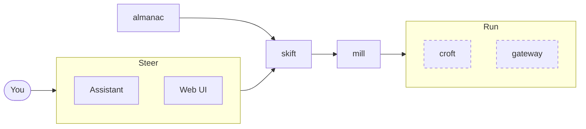

# Steading

Steading is a suite of software, and the project that builds it. Its website is [stead.ing](https://stead.ing/).[^steading] The name comes from homesteading: Steading is yours to build and customize to suit your "land." Each product offers a unique piece of the puzzle, so you start with what you need and swap pieces out.[^thicket] The [principles](principles.md) hold across all of it.

## Why

This kind of automation should be a commodity anyone can get, without a sales call, and the world is better with an open-source option. Nobody should have to build a software factory from scratch to benefit from one.[^governance] The architecture comes from using the tools, not from guessing what people might need.[^governance]

## Components

- [skift](skift.md) tracks the work.
- [mill](mill.md) works the stream of tasks in skift.
- [almanac](almanac.md) watches the world and gets eventful things into skift.
- [croft](croft.md) runs work in sandboxes and enforces their boundaries.
- [The gateway](gateway.md) brokers inference and limits what agents can do.
- [thicket](thicket.md) is an assistant to talk to, plugged into the rest of the stack.
- [kb](kb.md) is a knowledge base that agents query and that corrects itself.
- [The web UI](web-ui.md) shows the system to people.

[Repositories](repositories.md) says which repository holds each one.

croft and the gateway are dashed because they don't exist yet; mill does their work for now.[^croft][^mill]

## More than a software factory

Steading's architecture is one you can diagram and point to when discussing software factories, but Steading doesn't have to be a software factory the way most people think of one.[^almanac][^thicket] The stack is meant to be malleable. For algorithmic trading, an almanac workflow could watch Alpaca's websocket and webhooks, EDGAR filings, and the news. Trading hypotheses go to an assistant, which files skift nodes to investigate, run backtests, and kick off research, then reports back with findings. The whole system works autonomously and you steer it whenever you choose, which leaves you free for the unique pieces: integrations, data sourcing, and the trading system itself.[^thicket]

## Names

The components follow a cottagecore naming convention.[^thicket]

- **Steading:** homesteading.[^thicket]
- **skift:** a mix of Middle English and Scandinavian: shift, change, and switch, with plot, allot, and divide. Loosely, to share or portion a lot.[^thicket][^almanac]
- **mill:** works a stream of portioned tasks from skift.[^thicket][^almanac]
- **almanac:** a farmer's almanac, with its forecasts and moon cycles.[^almanac]
- **croft:** provisions the sandboxes and enforces the boundaries.[^thicket]

## In the open

Steading is built in the open, in the [steading-ai](https://github.com/steading-ai) GitHub organization, because building in the open and collaborating with others is more fulfilling.[^mill][^almanac] Steading is trying to grow a community of people who want exactly this system and architecture.[^steading] See [community](community.md), [governance](governance.md), and [contributing](contributing.md).

[^steading]: [Projects interview: steading](../sources/202611150814-projects-in-ivys-words.md#steading-aisteading)
[^thicket]: [Projects interview: thicket](../sources/202611150814-projects-in-ivys-words.md#steading-aithicket)
[^almanac]: [Projects interview: almanac](../sources/202611150814-projects-in-ivys-words.md#steading-aialmanac)
[^governance]: [Projects interview: governance](../sources/202611150814-projects-in-ivys-words.md#governance)
[^mill]: [Projects interview: mill](../sources/202611150814-projects-in-ivys-words.md#steading-aimill)
[^croft]: [Projects interview: croft](../sources/202611150814-projects-in-ivys-words.md#steading-aicroft)
